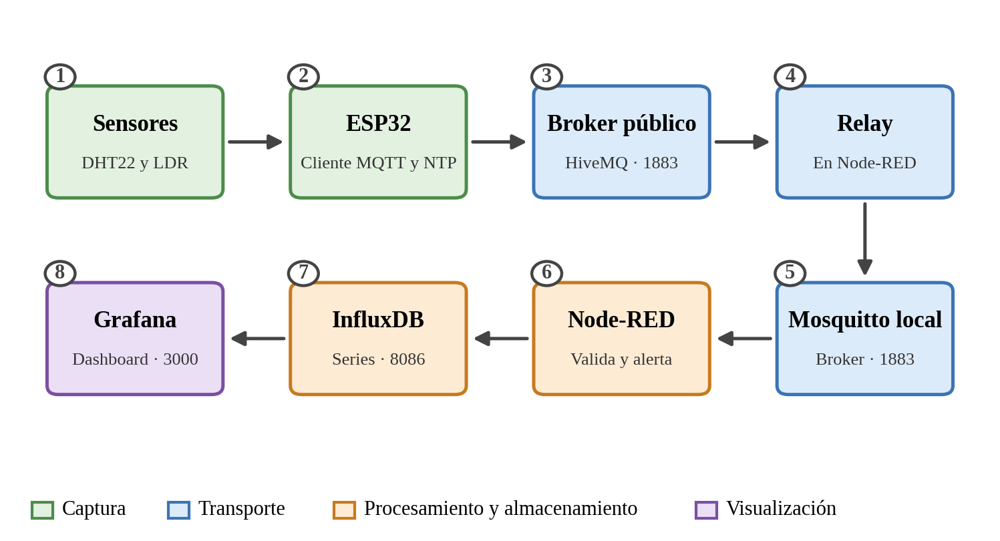
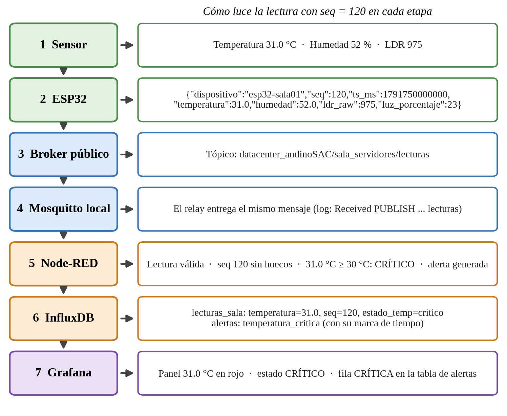
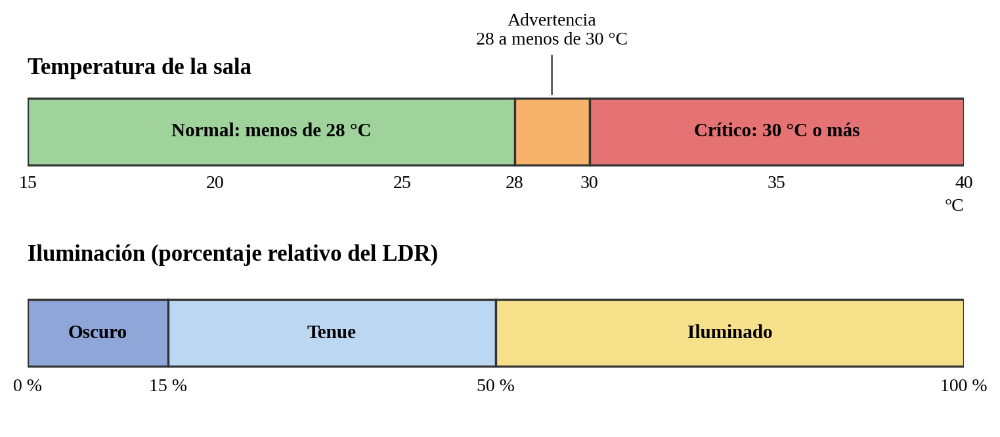
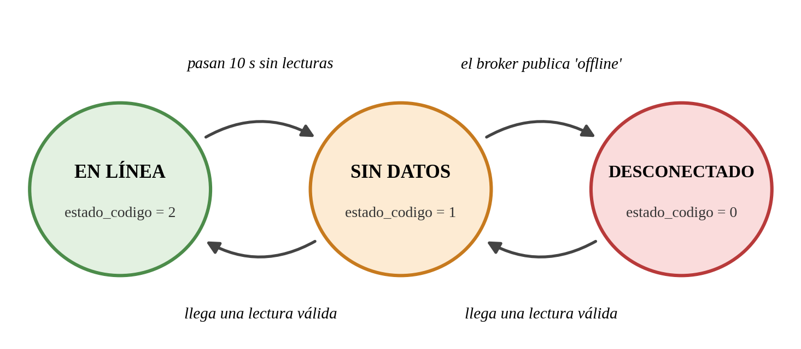
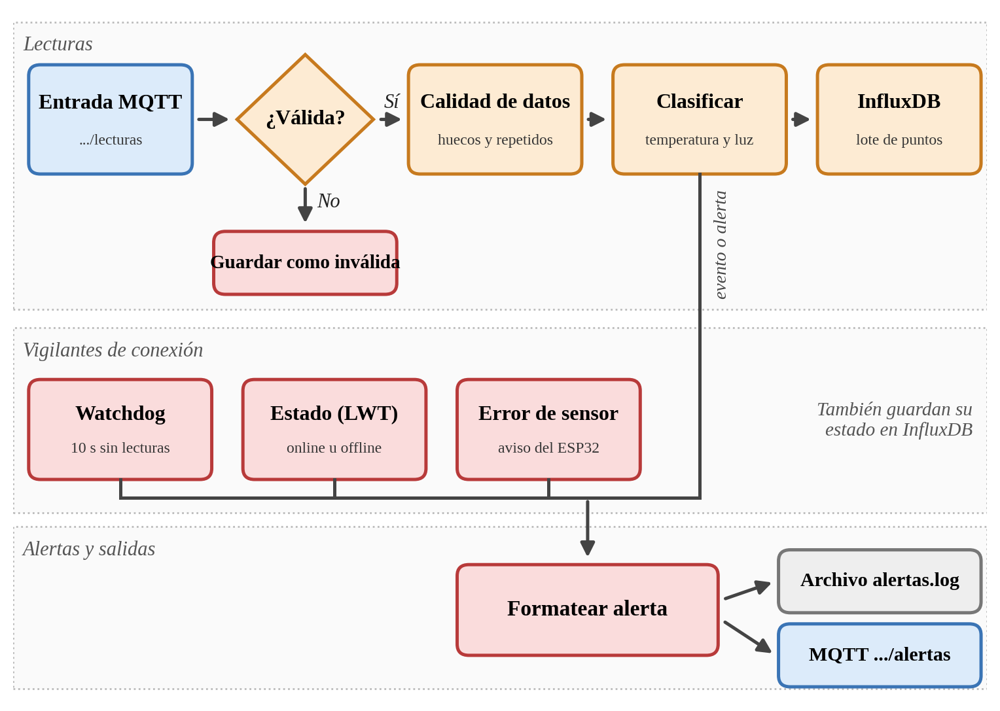

# Monitoreo IoT de temperatura e iluminación con ESP32, MQTT, Node-RED, InfluxDB y Grafana

Sistema que mide temperatura, humedad e iluminación con un nodo ESP32 (simulado en Wokwi o físico), publica las lecturas por MQTT, las recibe en un broker Mosquitto, las valida y clasifica en Node-RED, las almacena con marca de tiempo en InfluxDB y las muestra en un dashboard de Grafana. Se ejecuta directamente sobre Windows, sin contenedores.

## Contenido

1. [Descripción del sistema](#1-descripción-del-sistema)
2. [Arquitectura](#2-arquitectura)
3. [Estructura del repositorio](#3-estructura-del-repositorio)
4. [Requisitos](#4-requisitos)
5. [Instalación sin contenedores](#5-instalación-sin-contenedores)
6. [Configuración](#6-configuración)
7. [Arranque](#7-arranque)
8. [Pruebas](#8-pruebas)
9. [Solución de problemas](#9-solución-de-problemas)
10. [Seguridad y manejo de secretos](#10-seguridad-y-manejo-de-secretos)
11. [Limitaciones conocidas](#11-limitaciones-conocidas)

---

## 1. Descripción del sistema

| Función | Descripción |
|---|---|
| Adquisición | Lectura de temperatura y humedad (DHT22) y de luz (módulo LDR) cada 2 s |
| Transporte | Publicación MQTT con número de secuencia (`seq`) y hora de la medición (`ts_ms`, por NTP) |
| Validación | Control de formato, tipos y rangos de cada lectura; las inválidas se guardan aparte |
| Clasificación | Temperatura: normal, advertencia o crítico. Iluminación: oscuro, tenue o iluminado |
| Alertas | Un evento por cada cambio de estado, con recordatorio periódico mientras la temperatura siga crítica |
| Calidad de datos | Detección de mensajes perdidos, repetidos y reinicios del dispositivo mediante `seq` |
| Monitoreo de conexión | Vigilante de 10 s sin lecturas y mensaje de último deseo (LWT) del ESP32 |
| Almacenamiento | Series de tiempo en InfluxDB con etiquetas y campos tipados |
| Visualización | Dashboard con valores actuales, tendencias, estados, alertas e indicadores de desempeño |
| Registro de alertas | InfluxDB, archivo `alertas.log` y tópico MQTT `.../alertas` |

---

## 2. Arquitectura



| N.° | Componente | Tecnología | Versión | Puerto | Función |
|---|---|---|---|---|---|
| 1 | Sensores | DHT22 y módulo LDR | Wokwi | — | Miden temperatura, humedad y luz |
| 2 | Nodo IoT | ESP32 (Arduino, PubSubClient) | Wokwi, DevKit C v4 | — | Lee, arma el JSON y publica |
| 3 | Broker público | HiveMQ | `broker.hivemq.com` | 1883 | Recibe lo que publica el ESP32 |
| 4 | Relay | Flujo de Node-RED | 5.x | — | Copia los mensajes al broker local |
| 5 | Broker local | Mosquitto | 2.1.2 | 1883 | Distribuye los mensajes de la solución |
| 6 | Procesamiento | Node-RED sobre Node.js | 5.x y 24.14.1 | 1880 | Valida, clasifica y genera alertas |
| 7 | Almacenamiento | InfluxDB OSS | 2.9.1 | 8086 | Guarda las series de tiempo |
| 8 | Visualización | Grafana OSS | 13.2.3 | 3000 | Dashboard y consultas Flux |

Wokwi se ejecuta en la nube y no puede alcanzar un servidor en `localhost`; por eso el ESP32 publica en un broker público y un relay de Node-RED copia cada mensaje al Mosquitto local. Con un ESP32 físico en la misma red se puede omitir el relay: basta con apuntar `MQTT_SERVER` a la IP del equipo que ejecuta Mosquitto y no importar `nodered/flujo_relay.json`.



### Clientes MQTT

| Cliente | Función | Se conecta a | Identificador |
|---|---|---|---|
| ESP32 | Publica lecturas, estado y errores | `broker.hivemq.com:1883` | `esp32-sala01-<mac>` |
| Relay (lado público) | Se suscribe a `datacenter_andinoSAC/sala_servidores/#` | `broker.hivemq.com:1883` | `nodered-relay-remoto-andino` |
| Relay (lado local) | Republica en el broker local | `127.0.0.1:1883` | `nodered-relay-local-andino` |
| Flujo principal | Se suscribe a lecturas, estado y error; publica alertas | `127.0.0.1:1883` | `nodered-sala-servidores` |

---

## 3. Estructura del repositorio

```
.
├── README.md
├── .gitignore
├── .env.example
├── esp32/
│   ├── esp32_sala_servidores.ino
│   ├── libraries.txt
│   └── diagram.json
├── mosquitto/
│   └── local.conf
├── nodered/
│   ├── flujo_monitoreo.json
│   └── flujo_relay.json
├── influxdb/
│   ├── escritura_prueba.cmd
│   └── consultas/
│       ├── q1_ultimas_lecturas.flux
│       ├── q2_alertas.flux
│       ├── q3_estado_monitoreo.flux
│       ├── q3_calidad_datos.flux
│       ├── q4_lecturas_invalidas.flux
│       ├── q5_conteo_por_seq.flux
│       ├── q6_conteo_ventana_fija.flux
│       ├── ind1_porcentaje_recibidos.flux
│       ├── ind2_latencia.flux
│       └── ind3_deteccion_critica.flux
├── grafana/
│   ├── dashboard_sala_servidores.json
│   └── provisioning/datasources/influxdb.yaml
├── tests/
│   └── publicar_invalidos.cmd
├── docs/img/
└── evidencias/
```

| Ruta | Contenido |
|---|---|
| `esp32/` | Código del ESP32, librerías y circuito de Wokwi |
| `mosquitto/local.conf` | Configuración del broker local |
| `nodered/flujo_monitoreo.json` | Flujo principal exportado (sin credenciales) |
| `nodered/flujo_relay.json` | Flujo del relay entre el broker público y Mosquitto local |
| `nodered/exportado/` | Exportación directa de Node-RED, como copia de referencia |
| `influxdb/consultas/` | Consultas Flux de verificación e indicadores |
| `influxdb/escritura_prueba.cmd` | Escritura de un punto de prueba por la API |
| `grafana/dashboard_sala_servidores.json` | Dashboard exportado |
| `grafana/exportado/` | Exportación directa de Grafana, como copia de referencia |
| `grafana/provisioning/` | Ejemplo opcional de fuente de datos para aprovisionamiento |
| `tests/publicar_invalidos.cmd` | Publica tres mensajes inválidos de prueba |
| `evidencias/` | Carpeta para las capturas de las pruebas (no se versionan) |

---

## 4. Requisitos

### Software

| Software | Versión | Uso | Descarga |
|---|---|---|---|
| Windows | 10 u 11 de 64 bits | Sistema operativo | — |
| Mosquitto | 2.1.2 | Broker MQTT local | https://mosquitto.org/download/ |
| InfluxDB OSS | 2.9.1 | Base de datos de series de tiempo | https://download.influxdata.com/influxdb/releases/influxdb2-2.9.1-windows_amd64.zip |
| Node.js | 24.14.1 (mínimo 22.9) | Entorno de Node-RED | https://nodejs.org/ |
| Node-RED | 5.x | Procesamiento y relay | `npm install -g --unsafe-perm node-red` |
| node-red-contrib-influxdb | 0.7.0 | Nodos de escritura en InfluxDB 2 | Gestor de paletas de Node-RED |
| Grafana OSS | 13.2.3 | Dashboard | https://grafana.com/grafana/download?platform=windows |
| Git | Reciente | Clonar el repositorio | https://git-scm.com/ |
| Navegador | Reciente | Interfaces de Node-RED, InfluxDB, Grafana y Wokwi | — |

`curl.exe`, PowerShell y CMD vienen incluidos en Windows 10 y 11.

### Librerías del ESP32 (`esp32/libraries.txt`)

| Librería | Uso |
|---|---|
| PubSubClient | Cliente MQTT |
| DHT sensor library | Lectura del DHT22 |
| Adafruit Unified Sensor | Dependencia de la librería DHT |

### Hardware

Ninguno si se usa Wokwi. Con hardware físico: ESP32 DevKit, sensor DHT22, módulo LDR con salida analógica y una resistencia de 10 kΩ.

### Red

- Salida a internet para Wokwi, el broker público y el servidor NTP.
- Puertos locales libres: 1883, 8086, 1880 y 3000.

---

## 5. Instalación sin contenedores

### 5.1 Clonar el repositorio

```
git clone https://github.com/<usuario>/<repositorio>.git
cd <repositorio>
```

### 5.2 Mosquitto

1. Instalar Mosquitto 2.1.2 con el instalador de Windows de 64 bits.
2. Si se instaló como servicio, detenerlo (CMD como administrador):
   ```
   net stop mosquitto
   ```
3. La configuración usada es `mosquitto/local.conf` (ver [6.2](#62-mosquitto)).

### 5.3 InfluxDB

1. Descomprimir el zip en `C:\InfluxData` (PowerShell):
   ```
   mkdir C:\InfluxData
   Expand-Archive "$env:USERPROFILE\Downloads\influxdb2-2.9.1-windows_amd64.zip" -DestinationPath C:\InfluxData
   ren "C:\InfluxData\influxdb2-2.9.1-windows-amd64" influxdb
   ```
2. Iniciar el servidor:
   ```
   cd C:\InfluxData\influxdb
   .\influxd
   ```
3. Abrir http://localhost:8086 y completar la configuración inicial: usuario, contraseña, organización `DataCenterAndino` y bucket `sala_servidores`.
4. Crear los tokens de la sección [6.5](#65-influxdb).

### 5.4 Node.js y Node-RED

1. Instalar Node.js (versión 22.9 o superior; se probó con 24.14.1).
2. Instalar Node-RED:
   ```
   npm install -g --unsafe-perm node-red
   ```
3. Iniciarlo una vez para crear su carpeta de usuario:
   ```
   node-red
   ```
4. Instalar el nodo de InfluxDB. Desde el editor: menú ☰, Manage palette, pestaña Install, buscar `node-red-contrib-influxdb`. Por línea de comandos:
   ```
   cd %USERPROFILE%\.node-red
   npm install node-red-contrib-influxdb
   ```
   y reiniciar Node-RED.

### 5.5 Grafana

1. Descargar el zip de Grafana OSS para Windows y descomprimirlo en `C:\Grafana`.
2. Iniciarlo desde su carpeta `bin`:
   ```
   cd C:\Grafana\grafana-13.2.3\bin
   .\grafana.exe server
   ```
   Desde Grafana 13 ya no existe `grafana-server.exe`. Si indica que no encuentra los archivos de configuración, agregar `--homepath C:\Grafana\grafana-13.2.3`.
3. Abrir http://localhost:3000, ingresar con `admin` y `admin`, y cambiar la contraseña.

### 5.6 Proyecto de Wokwi

1. Crear un proyecto nuevo con la placa ESP32.
2. Reemplazar el contenido de la pestaña del programa por `esp32/esp32_sala_servidores.ino`.
3. Reemplazar `diagram.json` por `esp32/diagram.json` y `libraries.txt` por `esp32/libraries.txt`.
4. Iniciar la simulación y comprobar en el monitor serie los mensajes `Hora NTP sincronizada`, `conectado` y `Publicado OK`.

---

## 6. Configuración

### 6.1 Variables de entorno

Copiar `.env.example` a `.env` y completar los valores. El archivo `.env` está en `.gitignore` y nunca debe subirse.

| Variable | Descripción | Se usa en |
|---|---|---|
| `INFLUX_URL` | Dirección de InfluxDB (`http://127.0.0.1:8086`) | Scripts y consultas |
| `INFLUX_ORG` | Organización de InfluxDB | Scripts |
| `INFLUX_BUCKET` | Bucket de datos | Scripts |
| `INFLUX_TOKEN_NODERED` | Token de solo escritura | Script de escritura de prueba y nodo de InfluxDB |
| `INFLUX_TOKEN_GRAFANA` | Token de solo lectura | Fuente de datos de Grafana |
| `MQTT_BROKER_PUBLICO` | Broker al que publica el ESP32 | Referencia para el sketch y el relay |
| `MQTT_PORT` | Puerto MQTT | Referencia |
| `MQTT_BROKER_LOCAL` | Dirección del Mosquitto local | Referencia |
| `MQTT_PREFIJO` | Prefijo de los tópicos | Referencia |

Los scripts `.cmd` leen las variables del entorno de la sesión, no del archivo. Antes de ejecutarlos se definen en CMD:

```
set INFLUX_URL=http://127.0.0.1:8086
set INFLUX_ORG=DataCenterAndino
set INFLUX_BUCKET=sala_servidores
set INFLUX_TOKEN_NODERED=<token de escritura>
```

El token de Node-RED se escribe en el editor (6.6) y el de Grafana en su fuente de datos (6.7).

### 6.2 Mosquitto

Archivo `mosquitto/local.conf`:

```
listener 1883
allow_anonymous true

log_type error
log_type warning
log_type notice
log_type information
connection_messages true
```

| Parámetro | Valor | Efecto |
|---|---|---|
| `listener` | `1883` | Puerto MQTT sin cifrado |
| `allow_anonymous` | `true` | Acepta clientes sin usuario; solo para entorno de pruebas |
| `log_type` | `error`, `warning`, `notice`, `information` | Niveles registrados en consola |
| `connection_messages` | `true` | Registra conexiones y desconexiones |
| Opción `-v` al iniciar | — | Registro detallado de cada mensaje |

Sin un archivo con `listener`, Mosquitto 2.x arranca en modo solo local.

### 6.3 Tópicos MQTT

Prefijo: `datacenter_andinoSAC/sala_servidores/`

| Tópico | Publica | Se suscribe | QoS | Retenido | Contenido |
|---|---|---|---|---|---|
| `…/lecturas` | ESP32 | Flujo principal | 0 | No | JSON de la lectura |
| `…/estado` | ESP32 y broker (LWT) | Flujo principal | 1 | Sí | Texto `online` u `offline` |
| `…/error` | ESP32 | Flujo principal | 0 | No | JSON con el motivo del fallo del sensor |
| `…/alertas` | Flujo principal | Cualquier cliente | 1 | No | JSON con el evento generado |

### 6.4 Estructura de los datos

#### Mensaje de lectura (`…/lecturas`)

```json
{"dispositivo":"esp32-sala01","seq":120,"ts_ms":1791750000000,"temperatura":24.00,"humedad":52.0,"ldr_raw":975,"luz_porcentaje":23}
```

| Campo | Tipo | Descripción | Rango válido |
|---|---|---|---|
| `dispositivo` | texto | Identificador del ESP32 | No vacío |
| `seq` | número | Número de secuencia, empieza en 0 al reiniciar | 0 o mayor |
| `ts_ms` | número | Hora de la medición, milisegundos desde 1970 (UTC); 0 si no hay sincronización | Opcional |
| `temperatura` | número | Grados Celsius | −40 a 80 |
| `humedad` | número | Humedad relativa (%) | 0 a 100 |
| `ldr_raw` | número | Lectura cruda del ADC | 0 a 4095 |
| `luz_porcentaje` | número | Luz relativa (%) | 0 a 100 |

#### Mensaje de error (`…/error`)

```json
{"dispositivo":"esp32-sala01","error":"dht22_invalido"}
```

#### Mediciones en InfluxDB (bucket `sala_servidores`)

| Measurement | Etiquetas (tags) | Campos (fields) | Contenido |
|---|---|---|---|
| `lecturas_sala` | `dispositivo`, `sala` | `temperatura`, `humedad`, `ldr_raw`, `luz_porcentaje`, `seq`, `perdidos`, `estado_temp`, `estado_temp_codigo`, `estado_luz`, `estado_luz_codigo`, `latencia_ms`, `ts_dispositivo_ms` | Serie principal |
| `alertas` | `dispositivo`, `tipo`, `severidad` | `mensaje`, `temperatura`, `luz_porcentaje`, `tiempo_deteccion_ms` | Eventos y alertas |
| `estado_monitoreo` | `dispositivo`, `fuente` | `estado_codigo`, `estado_texto` | Estado de la conexión |
| `calidad_datos` | `dispositivo`, `tipo` | `perdidos`, `seq`, `seq_anterior` | Pérdidas y reinicios |
| `lecturas_invalidas` | `dispositivo`, `motivo` | `detalle`, `crudo` | Lecturas rechazadas |

| Campo | Valores |
|---|---|
| `estado_temp` y `estado_temp_codigo` | `normal` = 0, `advertencia` = 1, `critico` = 2 |
| `estado_luz` y `estado_luz_codigo` | `oscuro` = 0, `tenue` = 1, `iluminado` = 2 |
| `estado_codigo` (monitoreo) | `DESCONECTADO` = 0, `SIN_DATOS` = 1, `EN_LINEA` = 2 |

La marca de tiempo de cada punto la asigna Node-RED al recibir la lectura. `latencia_ms` y `tiempo_deteccion_ms` se calculan con `ts_ms` y solo se guardan si la diferencia con el reloj del equipo está entre −5 s y 30 s.

### 6.5 InfluxDB

| Elemento | Valor |
|---|---|
| Dirección | `http://localhost:8086` |
| Organización | `DataCenterAndino` |
| Bucket | `sala_servidores` |
| Retención | Sin límite (valor por defecto) |

Tokens (menú Load Data, API Tokens, Generate API Token, Custom API Token):

| Nombre | Permiso sobre el bucket `sala_servidores` | Lo usa |
|---|---|---|
| `node_red_escritura` | Write | Node-RED |
| `grafana_lectura` | Read | Grafana |

Desde InfluxDB 2.9 los tokens se guardan con hash: el valor completo solo se ve al crearlo y debe copiarse en ese momento.

Prueba de escritura (con las variables definidas en 6.1):

```
influxdb\escritura_prueba.cmd
```

La respuesta correcta empieza con `HTTP/1.1 204 No Content`.

### 6.6 Node-RED

1. Menú ☰, Import, seleccionar `nodered/flujo_monitoreo.json` e importar. Si ya existen nodos, elegir Replace.
2. Opcional (solo con Wokwi): importar `nodered/flujo_relay.json`.
3. Abrir el nodo `InfluxDB (escritura en lote)`, editar la configuración `InfluxDB local v2` y pegar en Token el valor de `node_red_escritura`. Verificar la URL `http://127.0.0.1:8086`, la organización y el bucket.
4. Confirmar que las configuraciones MQTT apunten a `127.0.0.1:1883` (flujo principal) y a `broker.hivemq.com:1883` (lado público del relay).
5. Ajustar la ruta del nodo `alertas.log` si no se usa `C:/proyecto_iot/logs/alertas.log` (la carpeta se crea sola).
6. Presionar Deploy. Los nodos MQTT deben mostrar `connected`.

Las credenciales no se incluyen en los archivos exportados.

#### Parámetros editables

Nodo `Parametros del sistema` (pestaña Setup), seguido de Deploy.

| Parámetro | Valor | Descripción |
|---|---|---|
| `umbral_advertencia` | 28 | Temperatura (°C) desde la que hay advertencia |
| `umbral_critico` | 30 | Temperatura (°C) desde la que es crítico |
| `temp_min_valida` y `temp_max_valida` | −40 y 80 | Rango válido de temperatura |
| `hum_min_valida` y `hum_max_valida` | 0 y 100 | Rango válido de humedad |
| `ldr_max` | 4095 | Valor máximo del ADC |
| `luz_oscuro_max` | 15 | Hasta este porcentaje, estado oscuro |
| `luz_tenue_max` | 50 | Hasta este porcentaje, estado tenue; por encima, iluminado |
| `ventana_inicio_h` y `ventana_fin_h` | 8 y 18 | Horario de mantenimiento (hora de Lima) |
| `recordatorio_critico_s` | 60 | Segundos entre recordatorios mientras siga crítico |
| `sala` | `sala_servidores` | Valor de la etiqueta `sala` |

Otros valores fijos: vigilante de 10 s sin lecturas (nodo `Watchdog 10 s sin datos`), una alerta de error de sensor cada 30 s y un aviso de fallo de InfluxDB cada 30 s como máximo.

#### Validación

| Revisión | Condición válida | Motivo si falla |
|---|---|---|
| Formato | JSON válido | `json_invalido` |
| Dispositivo | Texto no vacío | `dispositivo_faltante` |
| Temperatura | Número entre −40 y 80 | `temperatura_no_numerica`, `temperatura_fuera_de_rango` |
| Humedad | Número entre 0 y 100 | `humedad_no_numerica`, `humedad_fuera_de_rango` |
| LDR | Número entre 0 y 4095 | `ldr_no_numerico`, `ldr_fuera_de_rango` |
| Luz | Número entre 0 y 100 | `luz_no_numerica`, `luz_fuera_de_rango` |
| Secuencia | Número mayor o igual a 0 | `seq_invalido` |

#### Clasificación



| Variable | Estado | Condición |
|---|---|---|
| Temperatura | `normal` | Menos de 28 °C |
| Temperatura | `advertencia` | De 28 °C a menos de 30 °C |
| Temperatura | `critico` | 30 °C o más |
| Iluminación | `oscuro` | 15 % o menos |
| Iluminación | `tenue` | De 16 % a 50 % |
| Iluminación | `iluminado` | Más de 50 % |

#### Eventos

Las alertas de temperatura se generan solo al cambiar de estado.

| Evento (`tipo`) | Cuándo ocurre | Severidad |
|---|---|---|
| `temperatura_advertencia` | La temperatura llega a 28 °C | advertencia |
| `temperatura_critica` | La temperatura llega a 30 °C | critica |
| `temperatura_critica_persistente` | Sigue crítica tras `recordatorio_critico_s` | critica |
| `temperatura_normalizada` | Vuelve a estado normal | info |
| `iluminacion_fuera_de_ventana` | Luz alta fuera del horario de mantenimiento | info |
| `sin_datos` | 10 s sin lecturas | advertencia |
| `dispositivo_offline` | El broker publica el último deseo | advertencia |
| `dispositivo_online` | El ESP32 se conecta | info |
| `datos_recuperados` | Vuelven las lecturas tras un corte | info |
| `error_sensor` | El ESP32 informa un fallo del DHT22 | advertencia |
| `error_escritura_influxdb` | Falla una escritura en InfluxDB | critica |

#### Calidad de datos

| Situación | Detección | Registro |
|---|---|---|
| Mensajes perdidos | `seq` salta respecto al anterior | `calidad_datos` tipo `mensajes_perdidos` y campo `perdidos` |
| Mensaje repetido | Mismo `seq` consecutivo | Se descarta |
| Reinicio del ESP32 | `seq` menor que el anterior | `calidad_datos` tipo `reinicio_dispositivo` |

#### Estado de monitoreo



#### Flujo interno



### 6.7 Grafana

Fuente de datos (menú Connections, Data sources, Add data source, InfluxDB):

| Parámetro | Valor |
|---|---|
| Query language | Flux |
| URL | `http://127.0.0.1:8086` |
| Auth | Todo desactivado |
| Organization | `DataCenterAndino` |
| Token | `grafana_lectura` |
| Default Bucket | `sala_servidores` |
| Min time interval | `2s` |

Después de Save & test debe aparecer un mensaje de éxito.

Alternativa por aprovisionamiento: copiar `grafana/provisioning/datasources/influxdb.yaml` a la carpeta `conf/provisioning/datasources` de Grafana y definir `INFLUX_TOKEN_GRAFANA` en el entorno antes de iniciar Grafana.

Dashboard: menú Dashboards, New, Import, subir `grafana/dashboard_sala_servidores.json`, elegir la fuente InfluxDB y presionar Import. Si ya existe, confirmar Overwrite.

| Panel | Contenido |
|---|---|
| Temperatura actual y Estado de temperatura | Última lectura y su estado |
| Iluminación actual y Estado de iluminación | Última luz y su estado |
| Estado de monitoreo | En línea, sin datos o desconectado |
| Última lectura (fecha y hora) | Hora de la lectura más reciente |
| Tendencias | Temperatura y luz con líneas de umbral |
| Alertas y eventos registrados | Tabla de `alertas` |
| Estado de monitoreo en el tiempo | Línea de tiempo del estado de conexión |
| IND-1, IND-2, IND-3 y complemento | Indicadores de desempeño |
| Detecciones críticas | Tiempo de detección de cada alerta crítica |

El dashboard se actualiza cada 5 s y muestra por defecto los últimos 15 minutos.

### 6.8 ESP32 (Wokwi)

Constantes de `esp32/esp32_sala_servidores.ino`:

| Constante | Valor | Descripción |
|---|---|---|
| `DHT_PIN` | 4 | Pin de datos del DHT22 |
| `LDR_PIN` | 34 | Pin analógico del módulo LDR |
| `LDR_INVERTIDO` | `true` | Invierte el porcentaje porque el módulo simulado entrega más valor con menos luz |
| `WIFI_SSID` y `WIFI_PASS` | `Wokwi-GUEST` y vacío | Red Wi-Fi de Wokwi |
| `MQTT_SERVER` y `MQTT_PORT` | `broker.hivemq.com` y 1883 | Broker de publicación |
| `DEVICE_ID` | `esp32-sala01` | Identificador del dispositivo |
| `TOPIC_LECTURAS`, `TOPIC_ESTADO`, `TOPIC_ERROR` | Ver 6.3 | Tópicos de publicación |
| `INTERVALO_MS` | 2000 | Periodo de lectura |
| `RESYNC_NTP_MS` | 15000 | Periodo de resincronización de la hora |
| `NTP_1` y `NTP_2` | `pool.ntp.org` y `time.google.com` | Servidores de hora |

Conexiones:

| Componente | Pin del sensor | Pin del ESP32 | Cable |
|---|---|---|---|
| DHT22 | VCC | 3V3 | Rojo |
| DHT22 | SDA | GPIO 4 | Verde |
| DHT22 | NC | Sin conexión | — |
| DHT22 | GND | GND | Negro |
| Resistencia de 10 kΩ | Entre SDA y 3V3 | — | — |
| Módulo LDR | VCC | 3V3 | Rojo |
| Módulo LDR | GND | GND | Negro |
| Módulo LDR | DO | Sin conexión | — |
| Módulo LDR | AO | GPIO 34 | Verde |

Para cambiar de broker, modificar `MQTT_SERVER` en el sketch y el servidor del nodo `Broker publico (HiveMQ)` del relay; ambos deben coincidir.

Comportamiento del programa:

| Función | Descripción |
|---|---|
| Lectura del DHT22 | Hasta 3 intentos; descarta valores fuera de −40 a 80 °C |
| Mensaje de error | Si el DHT22 falla, publica `{"dispositivo":...,"error":"dht22_invalido"}` en `…/error` |
| Último deseo (LWT) | `offline` retenido en `…/estado` si el ESP32 se desconecta; `online` al conectar |
| Reconexión | Reintento cada 5 s sin bloquear las lecturas |
| Hora | NTP con resincronización periódica; `ts_ms` es 0 si no hay sincronización |

---

## 7. Arranque

Cada servicio corre en su propia ventana y se inicia en este orden:

| Paso | Servicio | Comando | Dirección |
|---|---|---|---|
| 1 | Mosquitto | `"C:\Program Files\Mosquitto\mosquitto.exe" -c mosquitto\local.conf -v` (desde la raíz del repositorio) | `127.0.0.1:1883` |
| 2 | InfluxDB | `cd C:\InfluxData\influxdb` y `.\influxd` | http://localhost:8086 |
| 3 | Node-RED | `node-red` | http://localhost:1880 |
| 4 | Grafana | `cd C:\Grafana\grafana-13.2.3\bin` y `.\grafana.exe server` | http://localhost:3000 |
| 5 | Wokwi | Iniciar la simulación con la pestaña visible | https://wokwi.com |

Verificación de los puertos:

```
netstat -ano | findstr "LISTENING" | findstr ":1883 :8086 :1880 :3000"
```

Deben aparecer los cuatro puertos. Los datos de InfluxDB se conservan en `C:\Users\<usuario>\.influxdbv2` entre reinicios.

---

## 8. Pruebas

### 8.1 Ventanas de observación

| Ventana | Comando | Muestra |
|---|---|---|
| Broker local | `mosquitto -c mosquitto\local.conf -v` | Conexiones y mensajes recibidos por Mosquitto |
| Publicado | `mosquitto_sub -h broker.hivemq.com -t "datacenter_andinoSAC/sala_servidores/lecturas" -v` | Lo que publica el ESP32 |
| Recibido | `mosquitto_sub -h localhost -t "datacenter_andinoSAC/#" -v` | Lecturas, estado y alertas en el broker local |

Los programas `mosquitto_sub` y `mosquitto_pub` están en `C:\Program Files\Mosquitto`.

### 8.2 Escenarios

| ID | Escenario | Entrada | Resultado esperado |
|---|---|---|---|
| P1 | Lecturas normales | DHT22 en 24 °C, LDR por defecto, 5 min | Estado `normal`, `perdidos` = 0, sin alertas |
| P2 | Advertencia | 27.9, 28.0 y 29.9 °C | Un único evento `temperatura_advertencia` al llegar a 28.0 |
| P3 | Temperatura crítica | 30.0 y 31.0 °C durante 75 s, luego 24 °C | `temperatura_critica`, línea en `alertas.log`, mensaje en `…/alertas`, `temperatura_critica_persistente` a los 60 s y `temperatura_normalizada` |
| P4 | Iluminación | LDR en 1, 10, 100, 500 y 5000 lux | Cambian `luz_porcentaje` y `estado_luz`; Grafana se actualiza en 10 s o menos |
| P5 | Interrupción | Detener Wokwi 45 s; cerrar Mosquitto 30 s | `sin_datos`, `dispositivo_offline`, `datos_recuperados`, `reinicio_dispositivo` y `mensajes_perdidos` |
| P6 | Mediciones inválidas | DHT22 en −40 °C y `tests\publicar_invalidos.cmd` | Registros en `lecturas_invalidas` y ninguno en `lecturas_sala` |
| P7 | Persistencia | Reiniciar InfluxDB 30 s | Mismo conteo y mismas marcas de tiempo |
| P8 | Publicados y recibidos | Ventana de 5 min sin reinicios | Publicados = recibidos = almacenados |

Notas:

- Los cambios de temperatura y luz se hacen con los controles del DHT22 y del LDR en Wokwi.
- En P4, ajustar `luz_oscuro_max` y `luz_tenue_max` según la tabla de calibración obtenida.
- En P6, el DHT22 en −40 °C o 80 °C se trata como lectura inválida; −31 °C es una lectura válida y se clasifica como `normal`.
- Los mensajes de `tests\publicar_invalidos.cmd` se publican en el broker local y no pasan por el broker público.

### 8.3 Consultas de verificación

Se ejecutan en InfluxDB, Data Explorer, Script Editor, activando View Raw Data.

| Archivo | Muestra |
|---|---|
| `influxdb/consultas/q1_ultimas_lecturas.flux` | Últimas lecturas con marca de tiempo |
| `influxdb/consultas/q2_alertas.flux` | Alertas y eventos de la última hora |
| `influxdb/consultas/q3_estado_monitoreo.flux` | Historial del estado de conexión |
| `influxdb/consultas/q3_calidad_datos.flux` | Pérdidas y reinicios |
| `influxdb/consultas/q4_lecturas_invalidas.flux` | Lecturas rechazadas y su motivo |
| `influxdb/consultas/q5_conteo_por_seq.flux` | Conteo de lecturas entre dos valores de `seq` |
| `influxdb/consultas/q6_conteo_ventana_fija.flux` | Conteo en una ventana de tiempo fija (UTC) |
| `influxdb/consultas/ind1_porcentaje_recibidos.flux` | Indicador de mensajes recibidos |
| `influxdb/consultas/ind2_latencia.flux` | Mediana de la latencia aparente |
| `influxdb/consultas/ind3_deteccion_critica.flux` | Tiempo de detección de alertas críticas |

En `q5` se editan los valores `120.0` y `270.0` por el `seq` inicial y final de la ventana, escritos con decimal. En `q6` se editan las horas en UTC (hora de Lima más 5 h).

### 8.4 Comparación de mensajes publicados y recibidos

1. Anotar el `seq` inicial del monitor serie de Wokwi.
2. Guardar lo recibido en un archivo (el destino debe existir y permitir escritura):
   ```
   mkdir C:\proyecto_iot\evidencias
   mosquitto_sub -h localhost -t "datacenter_andinoSAC/sala_servidores/lecturas" > C:\proyecto_iot\evidencias\recibidos.txt
   ```
3. A los 5 minutos, anotar el `seq` final y detener el comando con Ctrl+C.
4. Contar las líneas en PowerShell:
   ```
   (Get-Content C:\proyecto_iot\evidencias\recibidos.txt).Count
   ```
5. Ejecutar `q5_conteo_por_seq.flux` con ambos valores.

Publicados = `seq` final − `seq` inicial + 1. El resultado esperado es que los tres conteos coincidan.

### 8.5 Indicadores

| Indicador | Cálculo | Dónde se lee |
|---|---|---|
| IND-1, mensajes recibidos | recibidos ÷ (recibidos + perdidos) × 100, con `seq` | Panel IND-1 o `ind1_porcentaje_recibidos.flux` |
| IND-2, latencia aparente | Hora de llegada menos `ts_ms` (mínimo, mediana, percentil 95) | Panel IND-2 o `ind2_latencia.flux` |
| IND-3, tiempo de detección | Hora de la alerta crítica menos `ts_ms` de la lectura | Tabla Detecciones críticas o `ind3_deteccion_critica.flux` |
| Complemento, disponibilidad | Ventanas de 10 s con datos ÷ ventanas totales | Panel de disponibilidad |

En Wokwi el reloj simulado se atrasa respecto al tiempo real, por lo que IND-2 e IND-3 incluyen ese atraso. El tiempo de detección no incluye el intervalo de muestreo (hasta 2 s).

---

## 9. Solución de problemas

| Síntoma | Causa probable | Solución |
|---|---|---|
| Mosquitto muestra `Starting in local only mode` | No se cargó un archivo con `listener` | Iniciar con `-c mosquitto\local.conf` y revisar que el archivo no termine en `.txt` |
| Nodos MQTT de Node-RED en amarillo (`connecting`) | Mosquitto local no está corriendo | Iniciar Mosquitto (paso 1 del arranque) |
| ESP32 muestra `rc=3` o `rc=-4` | El broker público rechaza o corta la conexión por saturación | Reintentar o cambiar de broker en el sketch y en el relay |
| Wokwi publica pero Node-RED no recibe nada | Relay desactivado o broker distinto en el sketch y en el relay | Verificar que ambos usen el mismo broker y el mismo prefijo de tópicos |
| El nodo de InfluxDB marca error 401 | Token incorrecto o sin permiso de escritura | Volver a pegar `node_red_escritura` en la configuración del nodo |
| Error 404 al escribir | Organización o bucket distintos | Revisar `DataCenterAndino` y `sala_servidores` |
| El token aparece con puntos en Node-RED | Comportamiento normal: las credenciales no se muestran | Volver a pegar el valor si hay dudas |
| `unable to open boltdb: timeout` | Ya hay otro `influxd` abierto | Cerrar el proceso (`taskkill /IM influxd.exe /F`) y volver a iniciar |
| `grafana-server.exe` no existe | Grafana 13 usa un solo ejecutable | Usar `.\grafana.exe server` |
| Grafana muestra No data | Rango de tiempo sin datos, token de lectura incorrecto o fuente en InfluxQL | Ajustar el rango, revisar Save & test y usar lenguaje Flux |
| Más luz da un porcentaje menor | El módulo simulado entrega más valor con menos luz | Poner `LDR_INVERTIDO = true` |
| Latencia de varios segundos | Atraso del reloj simulado o reloj de Windows desfasado | Sincronizar Windows (`w32tm /resync` como administrador) y mantener la pestaña de Wokwi visible |
| Estado `DESCONECTADO` al iniciar | Mensaje `offline` retenido de una sesión anterior | Se actualiza solo cuando el ESP32 se conecta |
| El flujo no escribe `alertas.log` | La ruta del nodo no es válida | Editar la ruta en el nodo `alertas.log` |

---

## 10. Seguridad y manejo de secretos

| Elemento | Tratamiento |
|---|---|
| Tokens de InfluxDB | Se ingresan en Node-RED y Grafana; nunca se escriben en archivos del repositorio |
| Credenciales de Node-RED | Se guardan cifradas en `flows_cred.json`, ignorado por Git |
| Variables de entorno | Solo `.env.example` se versiona, sin valores reales |
| Exportación del flujo | Menú Export de Node-RED, que no incluye credenciales |
| Evidencias | La carpeta `evidencias/` no se versiona; las capturas deben ocultar tokens |
| Tokens por función | Un token de solo escritura para Node-RED y uno de solo lectura para Grafana |

Antes de cada commit se puede revisar qué archivos se subirán:

```
git status
git ls-files
```

---

## 11. Limitaciones conocidas

| Limitación | Efecto |
|---|---|
| Broker público y Mosquitto sin autenticación ni TLS | Los mensajes viajan sin cifrar y cualquiera que conozca el prefijo puede leerlos |
| Publicación con QoS 0 y sesión limpia | Los mensajes perdidos durante un corte no se recuperan |
| Sin almacenamiento intermedio ante caída de InfluxDB | Las lecturas de ese lapso no se guardan y IND-1 no las cuenta |
| Reloj simulado de Wokwi | La latencia y el tiempo de detección incluyen el atraso del simulador |
| Solo se vigilan temperaturas altas | No hay alerta de temperatura baja |
| Iluminación como porcentaje relativo | No son lux calibrados y no indican presencia de personas |
| Alertas solo en InfluxDB, archivo y MQTT | No hay notificaciones por correo ni mensajería |
